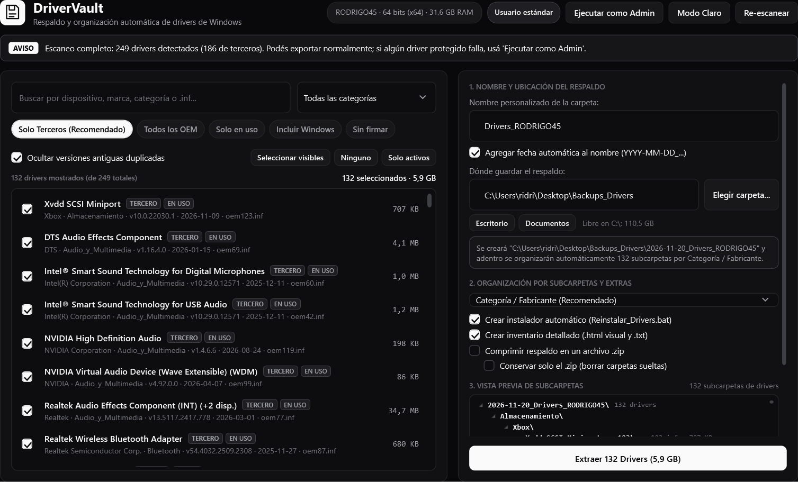
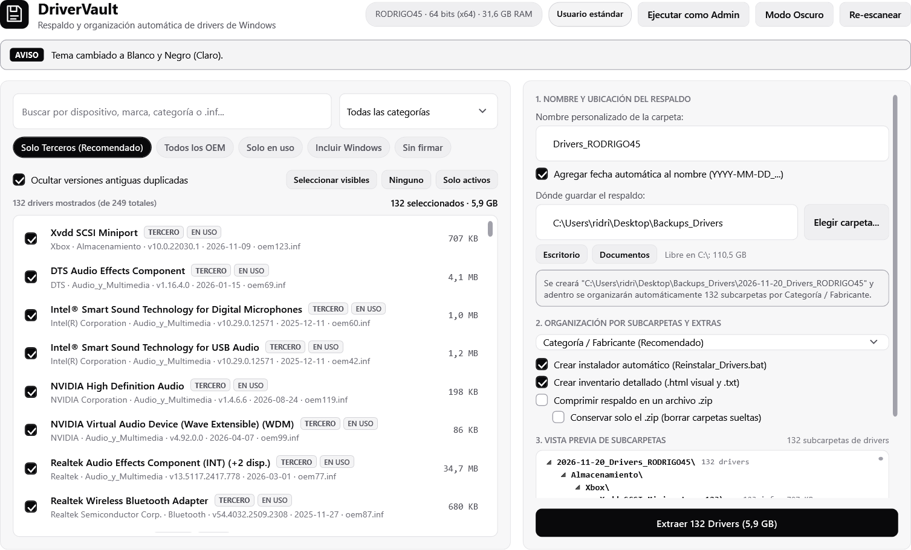

# DriverVault

**Extractor, organizador y respaldo portátil de drivers para Windows** — diseñado para que puedas guardar los controladores que ya funcionan bien en una PC (nueva o vieja) antes de formatear, cambiar de disco o migrar de sistema, con **avisos claros en cada paso** y un diseño moderno en **Blanco y Negro**.

---

## Capturas de pantalla

### Modo Oscuro (Blanco y Negro)


### Modo Claro (Blanco y Negro)


---

## ¿Qué hace DriverVault?

Cuando dejás una PC andando perfecto (sea una notebook antigua con drivers difíciles de conseguir o una PC moderna), querés asegurarte de no perder esos controladores si algún día formateás. **DriverVault** automatiza todo el proceso de forma segura usando APIs nativas de Windows (`Win32_PnPSignedDriver`, `SetupAPI` y `pnputil.exe`).

### Funciones principales y extras incluidos

- **Escaneo completo e independiente del idioma de Windows:** detecta drivers de terceros (`oem*.inf`), paquetes activos en uso, drivers desconectados guardados en `DriverStore` y drivers integrados de Windows.
- **Nombre personalizado del respaldo:** poné el nombre que quieras (ej. `Mi_PC_Oficina`, `Notebook_Vieja_Win10`) con prefijo automático de fecha opcional (`YYYY-MM-DD_...`).
- **Selector de destino con verificación de espacio:** elegí cualquier carpeta, pendrive o disco externo (con accesos rápidos a Escritorio y Documentos) y verificá el espacio libre antes de empezar.
- **Organización automática por subcarpetas:** elegí cómo acomodar tus drivers:
  - `Categoría / Fabricante` *(ej. `Video_y_Graficos\NVIDIA\...`, `Red_y_WiFi\Realtek\...`)*
  - `Solo por Categoría`
  - `Solo por Fabricante`
  - `Carpeta plana` *(una subcarpeta limpia por paquete)*
- **Vista previa en vivo del árbol de carpetas:** mirá exactamente qué subcarpetas y archivos se van a crear antes de apretar **Extraer**.
- **Avisos y confirmaciones en cada paso:**
  - Barra de avisos en tiempo real.
  - Ventana de confirmación previa que advierte cuántas subcarpetas se crearán, cuánto espacio ocupa, si tenés permisos de Administrador y qué hacer si la carpeta ya existe (crear nueva con hora o combinar).
  - Registro detallado en vivo durante la exportación y resumen final con botón para abrir la carpeta.
- **Filtros inteligentes:**
  - *Solo Terceros (Recomendado)*, *Todos los OEM*, *Solo en uso*, *Incluir Windows*, *Sin firmar* y buscador instantáneo.
  - Opción para ocultar versiones antiguas duplicadas en `DriverStore`.
- **Instalador automático incluido (`Reinstalar_Drivers.bat`):** genera un script dentro del respaldo para reinstalar todos los drivers con un clic (como Administrador) después de formatear.
- **Inventario visual y de texto (`Inventario_Drivers.html` y `Inventario_Drivers.txt`):** reporte monocromático imprimible con modelo del equipo, versión de Windows, fecha y tabla completa de cada driver y su subcarpeta.
- **Compresión opcional a `.zip`:** empaquetá el respaldo completo en un único archivo `.zip` (con opción de conservar solo el `.zip`).
- **Diseño moderno Blanco & Negro:** alterná al instante entre **Modo Oscuro** y **Modo Claro**.

---

## Tecnología elegida (estable para PCs viejas y modernas)

- **C# / .NET 8 WPF (`net8.0-windows`)**:
  - Consume muy poca memoria RAM y arranca rápido incluso en PCs antiguas con recursos limitados (a diferencia de apps basadas en navegador).
  - Escala con nitidez en pantallas modernas HiDPI / 4K (`PerMonitorV2`).
  - Se puede compilar como **un único ejecutable portable (`DriverVault.exe`)** sin requerir instalación compleja.

---

## Estructura del proyecto

```text
Extraer-Drivers-App/
├── DriverVault.sln
├── build-release.ps1               # Script para generar el .exe portable
├── docs/
│   ├── screenshot-dark.png
│   └── screenshot-light.png
├── src/DriverVault/
│   ├── Models/                     # Modelos de driver, opciones, resumen y vista previa
│   ├── Services/                   # Discovery (WMI + SetupAPI), InfParser, PathOrganizer, Export
│   ├── Themes/                     # Paletas Blanco/Negro (Dark & Light) y estilos WPF
│   └── Views/                      # MainWindow y diálogos de confirmación, progreso y resumen
└── tests/DriverVault.Tests/        # Pruebas unitarias (xUnit)
```

---

## Cómo compilar y ejecutar

### Requisitos para desarrollo
- Windows 10 o Windows 11
- [.NET 8 SDK](https://dotnet.microsoft.com/download/dotnet/8.0)

### Ejecutar en desarrollo y correr pruebas
```powershell
dotnet test DriverVault.sln -c Release
dotnet run --project src\DriverVault\DriverVault.csproj -c Release
```

### Generar un `.exe` portable listo para usar en cualquier PC
```powershell
.\build-release.ps1
```
El ejecutable final se genera en `release\win-x64\DriverVault.exe` (autocontenido, no requiere instalar .NET en la PC destino). Si necesitás soporte para PCs antiguas de 32 bits, podés ejecutar:
```powershell
.\build-release.ps1 -Runtime win-x86
```

---

## Cómo usar el respaldo después de formatear

1. Copiá la carpeta generada (o descomprimí el `.zip`) en la PC recién formateada.
2. Hacé clic derecho sobre **`Reinstalar_Drivers.bat`** → **Ejecutar como administrador**.
3. Confirmá el aviso en pantalla y dejá que `pnputil` instale todos los controladores de las subcarpetas automáticamente.
4. Si querés consultar qué versión tenía instalada antes, abrí **`Inventario_Drivers.html`** en cualquier navegador.
